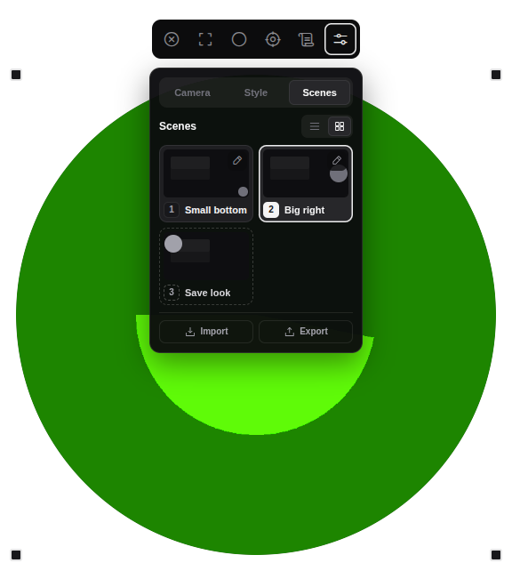
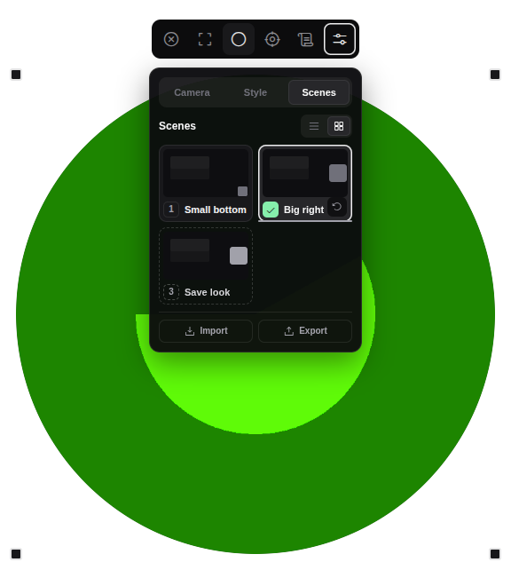
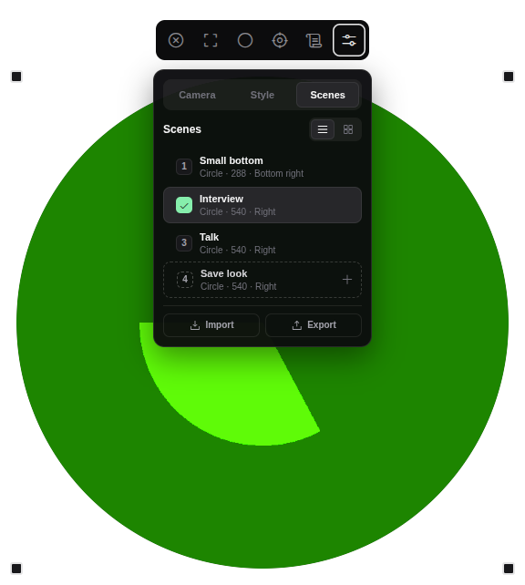
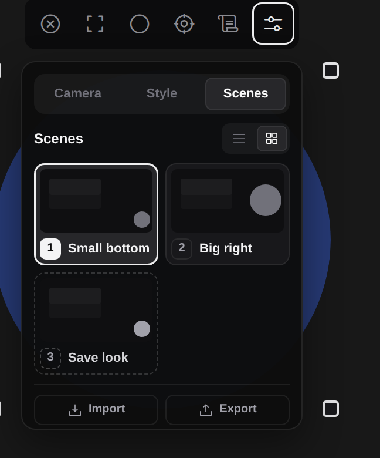
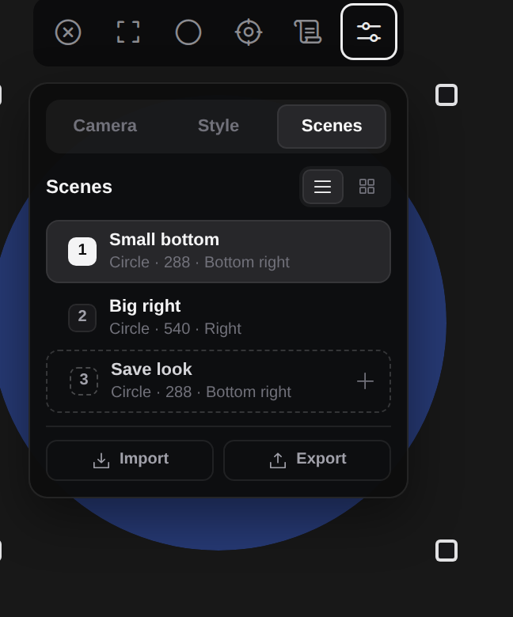
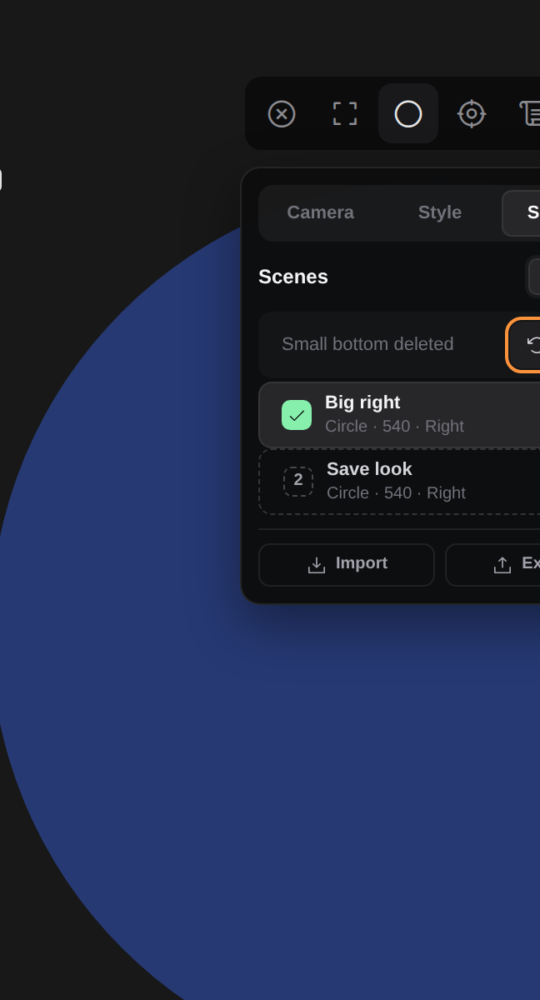

# Verification run: Scenes tab with list and grid, autosave and starter Scenes — 2026-11-09

- **Commit:** built on `dev` at `94afd7b`; the final hash is the PR's merge commit on `dev`
- **Version:** 0.7.0 (unchanged; no release)
- **Observer:** Claude Opus 5.5 (builder agent)
- **Environment:** Linux 7.0 (Wayland with XWayland, display :0), Node 24.22.2, development checkout; headless Chromium (playwright-core 1.63.0) for `kit shots`
- **Cameras:** none physical; Chromium's synthetic camera in the Electron smoke test
- **Related change/PR:** the PR that carries this file (Orbit TOOLS-132, ADR 0037)

## What changed

The Scenes tab holds only Scenes and Import/Export (ADR 0037): a list or a grid of small screens drawing each camera at its real place, size, shape and frame; the Scene on camera saves hand changes by itself, with a green check and Undo for 10 seconds; delete has Undo for 6 seconds; rename keeps the look; the settings stay open. Start at login, the shortcut list and the Prompter link section are gone (the toolbar button stays). New installations and older files without Scenes start with "Small bottom" and "Big right". Preferences schema 15.

## Automated checks

| Command | Result | Counts/duration | Evidence/notes |
| --- | --- | --- | --- |
| `scripts/agents/kit doctor` | Pass | 12/12 checks | |
| `scripts/agents/kit unit --affected` | Pass | 249/249, 10 files | `.scratch/unit/` |
| `npm test` (`node --test`) | Pass | 317 pass, 1 skipped (tag-build check, not a tag build) | |
| `npm run test:electron` | Pass | 4/4 | new: the Scenes tab test below; the Prompter link tests now drive the toolbar button only |
| `scripts/agents/kit shots` | Pass | 25 screenshots | starters, no Scenes and six Scenes in list and grid at 324x390 and 324x820; autosave, delete, rename, save form (Replace); high contrast focus; toolbar Prompter link off, on, busy |
| Syntax checks | Pass | `node --check` on every `src/*.js`, `preload.cjs`, the smoke and `shots` | |
| `git diff --check` | Pass | | |

New tests (each failed before its change):

- `test/settings.test.js`: schema 15; Start at login gone and an old schema-14 file with it still loads, keeping its Scenes; the one-time unregister only for a file that had it on; starter Scenes for a new installation and an older file without Scenes, none added from schema 15 on; the Scenes view.
- `test/scenes.test.js`: autosave of a hand change into the active Scene; the camera and its quality are never autosaved (a missing camera's fallback); nothing saved without an active Scene; a layout Scene turns into an exact Scene; rename keeps the look and refuses a taken name; delete reports what to restore and `restoreScene` puts it back in place; Undo of a change, also for a layout Scene with its live look; reorder by any offset; the 10 s and 6 s Undo windows; tile previews from real geometry.
- `test/scenes-panel.test.js`: place names, descriptions, tile drawing, the empty / Save look / Full slot, saved check and Undo timing, the deleted placeholder, layout Scenes drawn with the live look, Replace for a taken name.
- `test/bridge.test.js`: rename, undo change and undo delete channels. `test/overlay-geometry.test.js`: stopping a drag says whether one ran. `test/overlay-markup.test.js`: the removed controls stay removed, the icon glyphs exist in the font.
- `test/fixtures/preferences/`: load and sanitize expectations regenerated for schema 15 and reviewed (launchAtLogin gone, `sceneView` added, starters where a file has no Scenes), plus new cases for a schema-14 file with Scenes and Start at login, a schema-14 file without Scenes, and a schema-15 file without Scenes.

Real Electron (`scripts/electron-smoke.mjs`, "the Scenes tab applies, autosaves, undoes, deletes, renames, saves, and switches list and grid"), from a schema-14 file with Start at login on and no Scenes: the two starters arrive and `launchAtLogin` is gone; clicking Big right puts it on camera (window 576 px wide) and the settings stay open; its tile draws the camera at the right; the toolbar's Shape saves into Big right (green check, Undo shown); Undo restores the layout Scene and the circle; F2 rename keeps the layout; Save look adds "Interview" on camera; Delete shows Undo and Ctrl+Z brings the Scene back first in the list; Alt+Up moves Interview; grid arrows reach the nearest Scene above or below, also around a wide rename tile; the list view is kept; Escape closes the settings; the toolbar turns the Prompter link on, `GET /camframe/status` lists the three Scenes and a cue by name applies "Talk"; the saved file has schema 15, `sceneView: "list"`, no `launchAtLogin`. Screenshots from that run, in `2026-11-09-scenes-tab/`:

| Grid (Big right on camera) | Autosaved (check and Undo on Big right) | List |
| --- | --- | --- |
|  |  |  |

From `kit shots` (browser preview at the default 324x390 Overlay, 2x):

| Grid, starters | List, starters | List, a deleted Scene with Undo |
| --- | --- | --- |
|  |  |  |

## Build and artifact checks

| Target/check | Result | Artifact/hash/notes |
| --- | --- | --- |
| Windows unpacked | Not run | no release in this change |
| Windows NSIS | Not run | |
| Windows portable | Not run | |
| macOS arm64 DMG/ZIP | Not run | |
| macOS x64 DMG/ZIP | Not run | |
| ASAR/locales/fonts/permission metadata | Not run | |

## Manual checks

All Not run: they need Lex's Windows PC and a build that contains this change.

| ID | Result | Observation/evidence |
| --- | --- | --- |
| W-31 | Not run | Starters and their tiles on Lex's display; settings stay open on click |
| W-32 | Not run | Autosave from a real drag, a real corner resize, Shape and Glow |
| W-33 | Not run | Undo within 10 s, gone after 10 s |
| W-34 | Not run | Delete without a dialog, Undo within 6 s, gone after 6 s |
| W-35 | Not run | List/grid kept after restart; arrows, Enter, F2, Delete, Ctrl+Z, Alt+arrow, Escape; drag to reorder |
| W-36 | Not run | Empty state, Save look numbering, Full at six, Replace |
| W-25 | Not run | After updating a PC where Start at login was on, CamFrame no longer starts at sign-in |
| W-29 | Not run | NVDA reads the tile names, "on camera", "saved" and "<name> deleted" |
| W-30 | Not run | Prompter link from the toolbar button only; cues and the Scene list in the prompter still work |

Hand checks for Lex, in plain steps (Windows, with a build that has this change):

1. Open CamFrame, open the controls (sliders), go to Scenes. You see Small bottom and Big right. Each little screen shows where the camera will land.
2. Click Big right. The camera goes big on the right and the menu stays open.
3. Drag the camera somewhere else, then resize it from a corner. Big right's number turns into a green check and a round-arrow Undo button shows for about 10 seconds.
4. Click Undo before the line runs out. The camera jumps back to how Big right was.
5. Delete Small bottom with the trash button. No question pops up; "Small bottom deleted" with Undo shows in its place. Click Undo within 6 seconds: it comes back.
6. Switch between the list and grid icons, close CamFrame, open it again: it remembers the view.
7. If Start at login was on before: sign out and in. CamFrame should no longer start by itself.
8. Turn the Prompter link on with the scroll icon and run a script with `[Face: Big right]` and `[Face small, bottom right]`: both still switch the camera.

## Regressions and surprises

- Changing the look while an unedited starter is on camera gives that starter its own look; the other starter keeps following the live look until edited (ADR 0037, Consequences).
- A Prompter link cue that moves the camera still clears the active Scene, so autosave stops until a Scene is put on camera again (as designed: cues are not hand changes).
- The high-contrast screenshots show the selected settings tab's text drawn as a white block in emulated forced colors; this rule is older than this change and was not touched.

## Release decision

- **Decision:** Documentation baseline only (no release; lands on `dev`)
- **Reason:** behaviour change for the next release; any CamFrame release needs Lex's go
- **Known exceptions accepted by:** none
- **Follow-ups:** the hand checks above; numbered Prompter cues are a separate card
