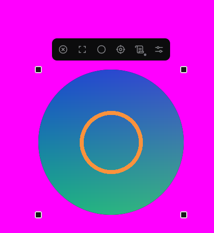
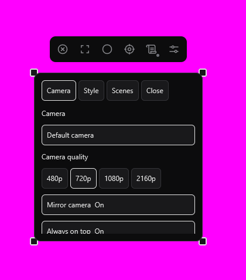
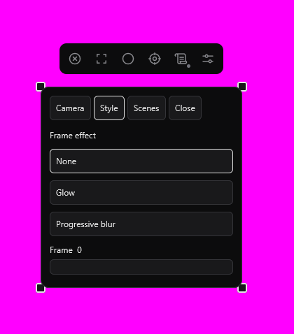
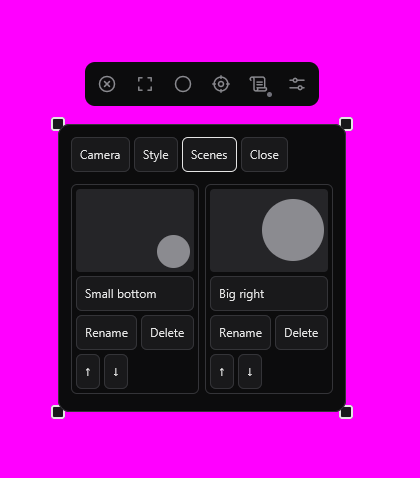
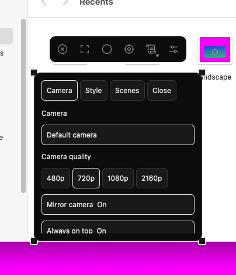
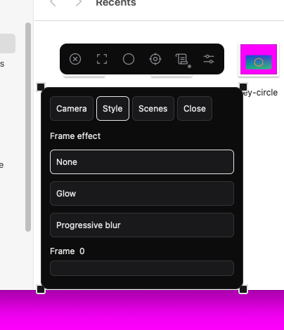
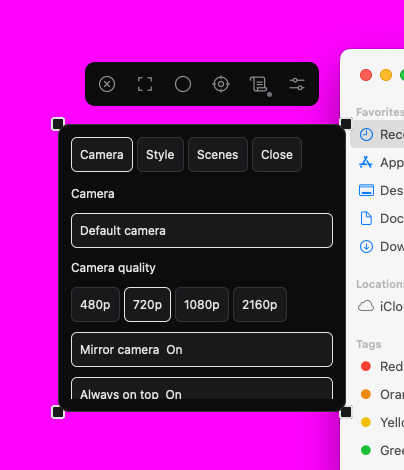

# Verification run: complete Rust test app — 2026-11-21

- **Commit:** implementation 6a29e490c9f702630cdcc5c4931358c025437e3c; final evidence commit follows.
- **Version:** 0.1.0, unreleased CamFrame Rust test app, beside CamFrame 0.9.0.
- **Observer:** implementation agent; independent Claude Opus reviews.
- **Environment:** Linux x64 development; Windows x64 and macOS 15 ARM/Intel CI desktops.
- **Cameras:** generated moving test picture. No physical camera available.
- **Related change/PR:** TOOLS-393; PR pending, no merge or release authorized.

## Scope and evidence

| Part | Implemented behavior | Detailed run |
| --- | --- | --- |
| 1 | Everyday bubble: camera, shapes, drag/resize, safe settings, native transparency and click-through | Prior builder commits through aafe2b2, two review rounds |
| 2 | Camera/Style controls, camera identity and hot-plug inventory, quality negotiation, mirror, framing, frame, Glow and Progressive blur | [Part 2](2026-11-21-rust-part-2.md) |
| 3 | Full screen/Compact transitions, display healing, six-button toolbar, global shortcuts, tray controls | [Part 3](2026-11-21-rust-part-3.md) |
| 4 | Six Scenes, starters, save/replace, autosave and Undo, deletion Undo, rename/reorder, list/grid, native import/export, layout Scenes | [Part 4 and first review ledger](2026-11-21-rust-part-4.md) |
| 5 | Opt-in API 2 Prompter link, cues, layout saves, small size, loopback/origin/body restrictions and null-origin redaction | [Part 5](2026-11-21-rust-part-5.md) |
| 6 | Simpler four-tip guide, persisted Skip/Finish, native motion/contrast updates, keyboard focus and accessible names/live changes | [Part 6](2026-11-21-rust-part-6.md) |
| 7 | Windows installer/Portable, Mac ARM/Intel DMG/ZIP, separate settings and app identity | [Part 7](2026-11-21-rust-part-7.md) |

Lex chose the simpler guide, so feature 55's ghost mouse is intentionally absent. Feature 68's
old login-registration cleanup and production switch-over remain held until his try and go, as
[ADR 0042](../../adr/0042-rust-test-downloads-and-native-controls.md) records. The three allowed
improvements are empty-corner click-through, visible shortcut failures and corrected mirrored
framing. Native camera selection uses a backend id; an imported Chromium id uses a unique saved
camera name or the default. The old app and its settings remain available.

## Automated checks

| Command | Result | Counts/duration | Evidence/notes |
| --- | --- | --- | --- |
| `kit doctor` | Pass after setup | 12/12 | First run failed on missing Playwright; shared `node_modules` symlink resolved it. No `npm ci`. |
| `kit rust` | Pass | 39 core tests, 3 shared fixture suites, 17 app tests | Formatting and Clippy included. |
| `kit unit --affected` | Pass | None affected | The Rust project command supplies its own suite. |
| `kit ux` | Cannot run | Missing `docs/agents/features.md` | Reported failure, not a native UI pass. |
| `kit shots` | Pass for Electron only | 25 screenshots | `.scratch/shots/2026-11-21T19-21-32-208Z`; native captures below provide the Rust evidence. |
| `kit status` | Cannot run | Command cut by kit TOOLS-235 | No status result inferred from it. |
| `kit panel-text` | Old Mac fails; fixed Mac and Windows pass | Old Mac 0 pixels; both fixed Macs 120; Windows 86 | Camera, Style and Scenes captures checked. |
| Independent main review | P1/P2 resolved; nits/test gaps remain | Claude Opus 5.5 high, 3 rounds for Parts 2–7 | Round 3: `camframe/.scratch/reviews/fleet-lead/20261121T194442Z`. [Round 2 fixes and ledger](2026-11-21-rust-review-fixes.md). |
| Other-family second look | Attempted; skipped | Grok weekly budget 8/8; free OpenCode usage limit | Evidence `camframe/.scratch/reviews/fleet-lead/20261121T194912Z`; GPT is the builder and is excluded. |

New behavior tests failed first with missing functions before implementation: quality selection,
halo generation, Compact restoration, Scene edits, Prompter validation, toolbar hotspot and
camera inventory/identity. Shared Preferences fixtures continue to cover schema 15 migrations,
sanitization and Scene imports. Socket tests exercise origin/host rejection and null redaction.

## Build and artifact checks

| Target/check | Result | Artifact/hash/notes |
| --- | --- | --- |
| Windows at 467f236 | Pass | [Run 44940333124](https://github.com/techiesreviews/camframe/actions/runs/44940333124), screenshot source below. |
| Final Windows | Pass | [Run 44942247339](https://github.com/techiesreviews/camframe/actions/runs/44942247339). |
| Final Mac ARM and Intel | Pass | [Run 44942247357](https://github.com/techiesreviews/camframe/actions/runs/44942247357). |
| Windows install/uninstall | Pass | Per-user silent install, binary hash comparison and uninstall. |
| Mac packages | Pass, both architectures | Ad-hoc signature verification, packaged binary desktop checks, ZIP and DMG integrity. |

Downloads are CI artifacts, not release assets. `camframe-rust-windows-x64` contains the installer
and Portable executable. `camframe-rust-macos-arm64-beta` and `camframe-rust-macos-x64-beta`
contain DMG and ZIP. Mac builds are machine-checked beta builds. No Developer ID, notarization,
Windows certificate, updater, version tag or published release is added by this work.

The committed [Windows demo measurements](2026-11-21-rust-final/windows-demo-benchmark.json)
are from one CI desktop at 6a29e49. The baseline is the self-extracting 0.9.0 Portable, whose
unpack time is part of its startup measurement. These are test-picture results; they do not
satisfy the card's real-camera performance gate or compare against an installed 0.9.0 start.

## Native GPUI screenshots

These are actual native app captures, not the Electron browser preview. The generated picture
avoids capturing a person. Captures are from 6a29e49. Transparent areas show the CI desktop behind
the bubble.

Everyday Windows bubble:


Toolbar:



Camera controls:



Style controls:



Scenes controls:



Mac ARM CI bubble and controls, with visible native labels after enabling `font-kit`:






Intel CI uses the same settings and passes the same text probe:



## Manual checks

| ID | Result | Observation/evidence |
| --- | --- | --- |
| W-01–W-37 complete Windows matrix | Not run | No Windows hardware or person attached. Native CI covers transparency, shape switching, input pass-through, drag and persistence only. |
| M-01–M-12 complete Mac matrix | Not run | No Mac hardware or person attached. CI cannot prove camera permission, driver continuity or usability. |
| Real camera, all qualities, rapid changes, unplug/replug | Not run | CPU resampling and driver refusal recovery require physical cameras. |
| Full screen continuity with the same capture | Not run manually | Capture worker is retained; real-device continuity remains unproven. |
| Progressive blur appearance and speed | Not run manually | Tests prove bounded halo generation, not visual equivalence under capture. |
| Prompter end-to-end on the user's page | Not run | API/transport tests pass; no prompter content changed. |
| Global shortcuts and tray on a person's desktop | Not run | Conflicts and native focus need a real session. |
| NVDA / VoiceOver and live OS preferences | Not run | Accessible names/state compile; spoken behavior remains unproven. |
| Lex's everyday bubble try | Pending | First requested try; no switch-over before his go. |

## Regressions and surprises

The Mac shape checks originally passed with blank text. Visual inspection caught this, and the
new pixel assertion reproduces it. GPUI's platform dependency did not enable `font-kit`, so the
Mac backend selected `NoopTextSystem`. The feature is now enabled; fixed ARM captures pass with
120 text pixels and appear above. Native-only menu API and deprecated shortcut issues were caught by CI
and corrected earlier. Earlier failed checks are retained in the per-part runs.

Round 3 confirmed R2-1 and R2-8–R2-15 resolved. Remaining P3 items are quality-refusal wording,
older run-document formatting, the unused old tray PNG, a duplicate shortcut-error prefix,
focus when a delete Undo expires, and the screenshot probe's fixed CI scale. Test gaps remain
for the quality-decision adapter, shortcut table, full presentation table, cue application,
drag dispatch, repeated refusal and the pixel counter. The reviewer explicitly ended the loop
because only nits and test gaps remain. No P1/P2 finding is waived.

`kit pr --no-merge` stopped because two standard MIT-license lines in the Phosphor notice
matched lines indexed from a local skill. Rewrapping did not resolve that false match. The Rust
icons' 2023 copyright is now consolidated into the repository's MIT `LICENSE`, with its complete
terms unchanged, and linked from the Rust README. The older Electron notice stays in place.
No skill content was copied, and the guard stays enabled.

## Release decision

- **Decision:** No-go for production replacement or release.
- **Done-when 1 (every feature on both systems, full checks):** implementation built; complete native human matrices remain unrun.
- **Done-when 2 (finished app beats 0.9.0 with a real camera):** not met; only demo CI measurements exist.
- **Done-when 3 (Lex tries and says go):** not met; try and go pending.
- **Known exceptions accepted by:** lead accepted R1-3 and R1-4 declines; the Part 4 ledger states the reasons.
- **Follow-ups:** finish independent reviews and native CI; open one PR to `dev` without merge; Lex tries the everyday bubble before deciding on replacement.

## Agent Kit result lines

Repeated identical Rust/test/help results are listed once. Red runs are retained with the final
green result; they are not presented as final failures. Native CI is separately linked above.

```text
RESULT: fail doctor 1 failed: playwright
RESULT: ok doctor 12/12 checks passed
RESULT: ok rulebook shared only
RESULT: fail cargo test
RESULT: fail cargo clippy
RESULT: fail cargo fmt (run 'cargo fmt --all' in rust/)
RESULT: pass cargo test and clippy (rust/)
RESULT: ok unit none affected
RESULT: fail ux ENOENT: no such file or directory, open '/home/ubulex/Projects/camframe-tools-393-sol/docs/agents/features.md'
RESULT: ok shots 25 screenshots evidence /home/ubulex/Projects/camframe-tools-393-sol/.scratch/shots/2026-11-21T18-43-07-142Z
RESULT: ok shots 25 screenshots evidence /home/ubulex/Projects/camframe-tools-393-sol/.scratch/shots/2026-11-21T19-21-32-208Z
RESULT: fail status cut
RESULT: ok deps help
RESULT: fail panel-text native labels missing
RESULT: ok panel-text native labels visible
RESULT: fail wait interrupted
RESULT: ok ci 6a29e490c9f702630cdcc5c4931358c025437e3c 6a29e49 green (2 workflows) after 43s
RESULT: ok review git diff aafe2b28210ef3981bc8926dc65cecfbcbeb497b...HEAD evidence /home/ubulex/Projects/camframe/.scratch/reviews/fleet-lead/20261121T185442Z
RESULT: ok review git diff aafe2b28210ef3981bc8926dc65cecfbcbeb497b...HEAD evidence /home/ubulex/Projects/camframe/.scratch/reviews/fleet-lead/20261121T192506Z
RESULT: ok review git diff aafe2b28210ef3981bc8926dc65cecfbcbeb497b...HEAD evidence /home/ubulex/Projects/camframe/.scratch/reviews/fleet-lead/20261121T194442Z
RESULT: skip second look (grok-4.7 grok review budget used up: 8/8 in 2026-W47; raise ASE_REVIEW_BUDGET_GROK to override; opencode/deepseek-v4.1-flash-free opencode usage limit: Free usage limit reached. Connect a provider or subscribe to OpenCode Go to keep going, or switch models.)
RESULT: fail skill-guard 2 problem(s); paid skills never go in a repo
RESULT: fail skills: problem: rust/app/assets/icons/Phosphor-LICENSE.txt:12: holds a line from the local skill visualize
```
